  
  
  
  
  
  

  

# 🧠 Awesome Machine Learning Frameworks 🚀

### 🌟 Top Machine Learning, Deep Learning, MLOps & LLM Frameworks Ecosystem

**Curated Directory of Cloud SaaS Platforms & Production-Grade Open-Source GitHub Repositories**  
*Comprehensive resource for End-to-End ML Platforms, Deep Learning Libraries, High-Throughput Inference Engines & Scalable AI Infrastructure.*

📅 **Last updated: October 2026**

---

## 📌 Introduction & Scope

Welcome to **Awesome-Machine-Learning-Frameworks**! This repository tracks premier **enterprise SaaS platforms** and high-velocity **open-source libraries** driving artificial intelligence, deep learning, statistical machine learning, high-concurrency LLM serving, and automated MLOps pipelines.

Whether you are architecting a multi-tenant cloud ML pipeline, conducting frontier generative AI research, or deploying ultra-low latency model inference on bare-metal clusters, this curated list provides direct comparisons, pricing tiers, star ratings, and architectural trade-offs.

---

## 📑 Table of Contents

- [📊 Sector Overview & Market Dynamics](#-sector-overview--market-dynamics)
- [☁️ SaaS & Hosted Enterprise ML Platforms](#️-saas--hosted-enterprise-ml-platforms)
- [💻 Open-Source GitHub Projects & Libraries](#-open-source-github-projects--libraries)
- [🤝 How to Contribute](#-how-to-contribute)
- [⭐ Star History](#-star-history)
- [💖 Support & Community](#-support--community)
- [⚠️ Disclaimer](#️-disclaimer)

---

## 📊 Sector Overview & Market Dynamics

The global machine learning platforms and infrastructure market is estimated at approximately **$130B to $210B+**, expanding rapidly at a **CAGR of 26%–33%**. 

The sector exhibits a distinct **bifurcated structure**:
- **Highly Concentrated Core (Hyperscaler Tier):** Foundational compute, high-availability orchestration, and managed GPU/TPU infrastructure are consolidated among an oligopoly (Microsoft Azure, Alphabet Google Cloud, Amazon Web Services).
- **Moderately Fragmented Tooling & Engine Tier:** Model fine-tuning, automated labeling, feature stores, experiment registries, distributed inference engines, and classical tabular ML remain dynamically fragmented across specialized independent software vendors and open-source ecosystems.

---

## ☁️ SaaS & Hosted Enterprise ML Platforms

| Product | Company Size (Market Cap / Valuation / Revenue) | Description | Starting Tier Pricing | Free Tier Limit |
| :--- | :--- | :--- | :--- | :--- |
| **[Google Vertex AI](https://cloud.google.com/vertex-ai)** | ~$4.0T Market Cap (Alphabet) | Google Cloud's unified ML platform with Gemini models, AutoML, custom training, and Vertex AI Pipelines. | Custom CPU training from $0.22/node-hr (`n1-standard-4`); GPU training add-on from $0.40/hr (NVIDIA T4) to $2.93/hr (A100); pay-as-you-go compute. | **$300 free trial credits** valid for 90 days across GCP; selective Llama preview models free during preview with rate limits (30–60 RPM). |
| **[Azure Machine Learning](https://azure.microsoft.com/en-us/products/machine-learning)** | ~$3.9T Market Cap (Microsoft) | Microsoft's cloud ML platform with designer (no-code), AutoML, notebooks, and MLOps integration. | No platform surcharge; pay-as-you-go VM compute starting from $0.02-$0.09/hr for basic burstable/CPU VMs, and $0.53/hr for GPU instances (NVIDIA T4 NC4as_T4_v3). | **$200 free trial credits** valid for 30 days plus 12 months of select popular free services; no separate permanent free ML platform tier. |
| **[AWS SageMaker](https://aws.amazon.com/sagemaker/)** | ~$2.8T Market Cap (Amazon) | End-to-end ML platform covering data prep, training, tuning, and deployment with Studio notebooks. | On-demand notebook/instance compute starting at $0.046/hr (`ml.t3.medium`) and $0.23/hr (`ml.m5.xlarge`); GPU instances starting at $3.83/hr (`ml.p3.2xlarge`). | **Free Tier (First 2 months)**: 250 hours/month of `ml.t2.medium`/`ml.t3.medium` notebooks, 50 hours/month of `ml.m4.xlarge` training, and 125 hours/month of `ml.m4.xlarge` hosting. |
| **[Databricks](https://databricks.com/)** | ~$134B Valuation (~$4.8B ARR) | Unified data and AI platform with MLflow, AutoML, and collaborative notebooks on Apache Spark. | Consumption-based DBU model starting at $0.07/DBU for serverless AI/model serving & jobs, $0.15/DBU for data pipelines, and $0.40-$0.55/DBU for all-purpose interactive compute (+ cloud VM costs). | **14-day free trial** with up to $400 in cloud credits; **Free Community/Personal Edition** limited to 1 serverless workspace with micro compute for non-commercial educational use. |
| **[Scale AI](https://scale.com/)** | ~$29B Valuation (~$2.0B Revenue) | Data platform for AI development, specializing in training data, model evaluation, and RLHF. | Pilot/starter annotation and data engine projects start at ~$1,000-$5,000/month; enterprise RLHF and evaluation contracts scale up to ~$93,000+/year. | **No permanent free tier**; self-serve trial/onboarding sandbox provides access to test suites and limited sample data labeling upon sales engagement. |
| **[DataRobot](https://www.datarobot.com/)** | ~$6.3B Peak Valuation (~$250M ARR) | Automated ML platform with AutoML, MLOps, and generative AI capabilities. | Enterprise annual software subscriptions starting at ~$50,000/year for baseline team editions with packaged AI compute units and user seats. | **30-day self-service SaaS trial** with full platform capabilities, batch predictions only, 15 vector DBs, 1,000 LLM calls, and up to 5 team members. |
| **[Dataiku](https://www.dataiku.com/)** | ~$3.7B Valuation (~$350M ARR) | Collaborative data science platform with visual and code-based workflows, plus LLM Mesh for multi-model orchestration. | Commercial team packages start at ~$4,000/month (typically contracted from ~$25,000-$50,000/year depending on user licenses and tier). | **14-day Cloud Trial** (fully managed, up to 5 users, 4 CPUs, 32 GB compute); also offers a perpetual **Free Edition** for local/on-prem single-server use restricted to 3 users and core data prep features. |
| **[H2O.ai](https://h2o.ai/)** | ~$1.7B Valuation (~$75M ARR) | Enterprise AI platform with Driverless AI (AutoML) and the open-source H2O-3 library. | Driverless AI commercial annual licenses starting at ~$12,000-$25,000/year for single-node deployments; enterprise multi-node cloud clusters scale higher. | **H2O-3 Core is 100% Free forever** (open-source Apache 2.0 with unlimited cluster nodes); **Driverless AI** offers a **21-day free trial** with full feature evaluation. |
| **[Domino Data Lab](https://domino.ai/)** | ~$915M Valuation (~$35M ARR) | Enterprise MLOps platform with on-demand compute, experiment tracking, and model deployment. | Commercial platform subscriptions starting at ~$50,000/year base tier, priced per user role (Data Science Professional / Data Analyst seats) plus compute infrastructure. | **No self-service free tier**; guided **30-day Proof of Concept (PoC) / trial** available through enterprise sales and cloud marketplace arrangements. |

---

## 💻 Open-Source GitHub Projects & Libraries

*Ranked strictly in descending order of GitHub community stars. Star badges dynamically link to the repository stargazers page.*

1. **[TensorFlow](https://github.com/tensorflow/tensorflow)**   
   📦 **The Production-Scale Standard (201k+ ⭐, Apache 2.0)**  
   Google's battle-tested end-to-end open-source machine learning framework. Features TensorFlow Serving for low-latency production microservices, TF Lite for edge/mobile devices, and TensorBoard for telemetry. Ideal for enterprise deployments needing stable compilation and TPU hardware acceleration.

2. **[Hugging Face Transformers](https://github.com/huggingface/transformers)**   
   🤗 **The Universal NLP & Generative AI Hub (168k+ ⭐, Apache 2.0)**  
   The definitive open-source standard for thousands of pre-trained state-of-the-art models spanning NLP, vision, audio, and multimodal tasks. Seamlessly integrates with PyTorch, TensorFlow, and JAX for fine-tuning and deployment.

3. **[PyTorch](https://github.com/pytorch/pytorch)**   
   🔥 **The Research & Dynamic Graph Workhorse (104k+ ⭐, BSD-3-Clause)**  
   The dominant dynamic computation graph framework powering academic AI breakthroughs and frontier model development. Offers Pythonic ergonomics, TorchScript JIT compilation, and TorchServe for scalable microservice deployments.

4. **[vLLM](https://github.com/vllm-project/vllm)**   
   ⚡ **High-Throughput Distributed LLM Serving (95k+ ⭐, Apache 2.0)**  
   High-performance inference engine for LLMs featuring PagedAttention for near-optimal memory utilization, continuous batching, chunked prefill, and native tensor parallelization across GPUs.

5. **[scikit-learn](https://github.com/scikit-learn/scikit-learn)**   
   ⚙️ **The Classical Machine Learning Foundation (67k+ ⭐, BSD-3-Clause)**  
   The golden standard in Python for tabular ML, feature extraction, regression, clustering, preprocessing, and model validation. Fast, robust, and clean object-oriented APIs built on NumPy, SciPy, and Cython.

6. **[Keras](https://github.com/keras-team/keras)**   
   🎯 **The Multi-Backend High-Level API (64k+ ⭐, Apache 2.0)**  
   Human-centric deep learning framework that runs seamlessly across PyTorch, JAX, and TensorFlow backends. Drastically reduces boilerplate while offering rapid prototyping and reproducible experimentation.

7. **[Ray](https://github.com/ray-project/ray)**   
   🌐 **Unified Distributed AI & Compute Scaling (44k+ ⭐, Apache 2.0)**  
   Unified computing framework for scaling AI and Python applications from single laptops to vast cloud clusters. Powers distributed hyperparameter tuning (Ray Tune), distributed training (Ray Train), and low-latency model serving (Ray Serve).

8. **[JAX](https://github.com/google/jax)**   
   🧪 **Composable Transformations & Accelerated Linear Algebra (36k+ ⭐, Apache 2.0)**  
   Combines Autograd and XLA compilation for composable functional array programming, reverse-mode autodiff, vectorization (`vmap`), and distributed TPU/GPU parallel execution (`pmap`).

9. **[PyTorch Lightning](https://github.com/Lightning-AI/pytorch-lightning)**   
   ⚡ **Modular PyTorch Engineering Wrapper (31k+ ⭐, Apache 2.0)**  
   Decouples research code from engineering boilerplates, automating multi-GPU/TPU distributed training, 16-bit mixed precision, and checkpoint management while preserving raw PyTorch flexibility.

10. **[XGBoost](https://github.com/dmlc/xgboost)**   
    🌲 **The Gold Standard Gradient Boosting Framework (28k+ ⭐, Apache 2.0)**  
    Scalable, portable, and distributed gradient boosting library engineered for efficiency and speed across tabular classification, regression, and ranking. Benchmarked heavily in Kaggle competitions.

11. **[MLflow](https://github.com/mlflow/mlflow)**   
    📈 **End-to-End MLOps Lifecycle Management (28k+ ⭐, Apache 2.0)**  
    Open platform to track experiments, package code into reproducible runs, register model artifacts, and manage model versioning and production deployment across cloud endpoints.

12. **[FastAI](https://github.com/fastai/fastai)**   
    🚀 **Productive Deep Learning with Layered Architecture (28k+ ⭐, Apache 2.0)**  
    Simplifies training fast and accurate neural networks using modern best practices baked directly into opinionated high-level abstractions over PyTorch.

13. **[ONNX](https://github.com/onnx/onnx)**   
    🔄 **Open Neural Network Exchange & Interoperability Format (21k+ ⭐, Apache 2.0)**  
    Universal intermediate representation format for AI models, enabling seamless interoperability between frameworks (PyTorch, TensorFlow, Scikit-learn) and deployment runtimes (ONNX Runtime, TensorRT).

14. **[LightGBM](https://github.com/microsoft/LightGBM)**   
    🍃 **Memory-Optimized Leaf-Wise Gradient Boosting (18k+ ⭐, MIT)**  
    Microsoft's high-speed gradient boosting framework utilizing tree-based learning algorithms with histogram binning and leaf-wise tree splitting for minimal memory consumption.

15. **[Kubeflow](https://github.com/kubeflow/kubeflow)**   
    ☸️ **Cloud-Native Kubernetes ML Orchestrator (15k+ ⭐, Apache 2.0)**  
    The cloud-native machine learning platform for Kubernetes. Provides composable ML pipelines, Katib hyperparameter tuning, interactive Jupyter notebooks, and scalable KServe inference topologies.

16. **[Triton Inference Server](https://github.com/triton-inference-server/server)**   
    🖥️ **Enterprise Multi-Framework Inference Server (11k+ ⭐, BSD-3-Clause)**  
    NVIDIA's production-grade multi-model serving engine supporting TensorRT, ONNX Runtime, PyTorch, and TensorFlow on both GPUs and CPUs with dynamic batching and concurrent execution.

17. **[CatBoost](https://github.com/catboost/catboost)**   
    🐱 **Categorical Gradient Boosting with Symmetric Trees (9k+ ⭐, Apache 2.0)**  
    Yandex's fast gradient boosting algorithm providing state-of-the-art out-of-the-box handling of categorical features and minimal overfitting via oblivious trees.

18. **[BentoML](https://github.com/bentoml/BentoML)**   
    🍱 **The Unified Model Serving & API Framework (8k+ ⭐, Apache 2.0)**  
    Packages trained models from any framework into production microservices with adaptive batching, multi-model composition, container generation, and easy cloud/Kubernetes deployment.

---

## 🤝 How to Contribute

We love community contributions! To suggest an update, add a framework, or refine benchmarking metrics:

1. 🍴 **Fork the repo** to your GitHub account.
2. 🌿 **Create a branch** for your feature (`git checkout -b feature/new-ml-framework`).
3. 📝 **Add/edit entries** in `README.md` maintaining alphabetical SaaS and star-ranked open-source tables. Include:
   - Tool name & official documentation link
   - Real starting tier pricing or verified star badges
   - Specific free tier and trial limits
4. 📬 **Submit a Pull Request** with a clear explanation of changes.

---

## ⭐ Star History

---

## 💖 Support & Community

Thank you so much for exploring and supporting **Awesome-Machine-Learning-Frameworks**! If you find this directory valuable for your machine learning engineering workflows, research, or architecture decisions, please consider supporting the project:

- ⭐ **Star this repository** to help others discover it across GitHub.
- 🍴 **Fork and share** with fellow data scientists, ML engineers, and dev communities.
- ☕ **Buy me a coffee / Sponsor the project**: Support continuous research and maintenance on the [GitHub Sponsor Dashboard](https://github.com/sponsors/ishandutta2007).
- 💬 **Join our community**: Chat and exchange insights on [Discord](https://discord.gg/jc4xtF58Ve).

---

## ⚠️ Disclaimer

- This is a **community-curated directory** provided for educational and architectural reference only—not a commercial endorsement.
- **Framework selection depends on specific workloads**:
  - Frontier Research & Dynamic Networks → **PyTorch**, **JAX**
  - Production Deep Learning & TPU Clusters → **TensorFlow**
  - High-Concurrency LLM Serving → **vLLM**, **Triton**
  - Classical Structured/Tabular ML → **scikit-learn**, **XGBoost**, **LightGBM**, **CatBoost**
  - Full-Scale MLOps & Experiment Tracking → **MLflow**, **Kubeflow**, **Ray**
- **SaaS Pricing Transparency**: Managed cloud enterprise solutions (Dataiku, DataRobot, Domino, Scale AI) frequently operate on custom annual contract quotes. Always verify with official vendors prior to architectural commitments.
- Free trial tiers are designed for sandbox prototyping and evaluation rather than production workloads.

---

**Crafted with ❤️ for data scientists, ML engineers, and AI systems architects worldwide.**  
*Accelerating open, performant, and reproducible machine learning ecosystems.*

